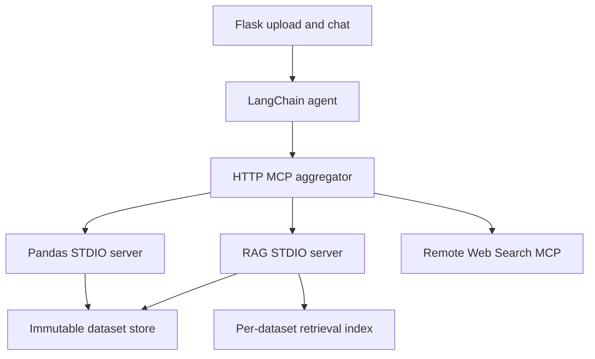

# MCP Data Analytics Agent — MCP Data Analytics AI Agent

A local Python application implementing the supplied **MCP Data Analytics AI Agent Project Guide**. Upload CSV or Excel, select the worksheet and project scope, and ask questions backed by exact Pandas calculations, retrieved dataset context, and optional remote web research.

**Start here:** use Python **3.12**. Core analytics and lexical retrieval run without API credentials. AI chat requires a tool-calling model and your LLM key. External research requires a configured remote MCP provider. Semantic retrieval is available through the optional Sentence Transformers + FAISS backend. The default TF-IDF backend is lexical, not semantic.

## 1. What is included

- Flask interface with file upload, raw sheet preview, schema, missing counts, chat, evidence tables and direct tool testing.
- Six Pandas tools: dataset information, column summaries, aggregation, GroupBy, validated filters and planned/actual date comparison.
- Three RAG tools: persistent indexing, contextual search and index information.
- A FastMCP Streamable HTTP aggregator launching local analytics/RAG servers via STDIO and optionally proxying a remote search server.
- A LangChain agent that discovers tools from the single aggregator endpoint and runs multi-tool conversations.
- Session-bound dataset access, upload validation, CSRF protection and bounded tool output.
- Tests, recorded sample outputs, a dependency snapshot, original Titanic CSV, and an anonymous **synthetic** project-plan workbook.

The existing RAG application's source and the real ProjectPlan.xlsx were not attached to this request. A complete replacement RAG server is included; see section 9 to plug in the existing one. `ProjectPlan_SAMPLE.xlsx` is teaching data, not a reconstruction or analysis of the real project.

## 2. Architecture



The browser talks to Flask. Chat uses the LangChain MCP adapter; direct tool testing uses a FastMCP client. Both connect to `http://127.0.0.1:8000/mcp`. Dataset ingestion is in Flask's shared service layer, never in the aggregator. Analytics and retrieval receive the same immutable dataset identifier and read the same normalized table.

Local subprocesses use the active Python interpreter (`sys.executable`), avoiding a separate Python installation or mismatched venv. Run commands from the project directory. Logs from MCP servers go to stderr; stdout is reserved for protocol messages.

## 3. Windows setup (PowerShell)

Extract the ZIP, then open PowerShell inside `MCP_Data_Analytics_Project`:

```powershell
py -3.12 -m venv .venv
.\.venv\Scripts\python.exe -m pip install --upgrade pip
.\.venv\Scripts\python.exe -m pip install -r requirements.txt
Copy-Item .env.example .env
notepad .env
```

No PowerShell activation or execution-policy change is necessary. Configure credentials in `.env`, then:

```powershell
.\.venv\Scripts\python.exe scripts/start.py
```

Open **http://127.0.0.1:5000**. Ctrl+C stops both services. If you change `.env`, stop and restart both services.

For separate terminals (useful when learning each component):

```powershell
# Terminal 1
.\.venv\Scripts\python.exe -m aggregator.aggregator_server
# Terminal 2
.\.venv\Scripts\python.exe app.py
```

## 4. Linux/macOS setup

```bash
python3.12 -m venv .venv
.venv/bin/python -m pip install --upgrade pip
.venv/bin/python -m pip install -r requirements.txt
cp .env .env
# Edit .env in your editor.
.venv/bin/python scripts/start.py
```

All later `python` commands assume your venv is activated, or use its full executable path as above.

`requirements.txt` pins direct dependencies tested on Linux/Python 3.12. `requirements-lock-linux-py312.txt` records the complete tested core environment, including development dependencies. Use the direct requirements for Windows/macOS; some transitive packages in the Linux snapshot are platform-specific. The optional semantic stack has its own requirements file and was not installed or runtime-validated here.

## 5. Configure AI chat and web search

### OpenRouter

In `.env`, set `OPENROUTER_API_KEY` to your actual key and `MODEL` to a **tool-calling model ID available in your account**. Keep `LLM_BASE_URL` blank to use `https://openrouter.ai/api/v1`. No model name is hardcoded because provider availability varies. Model requests may incur provider charges.

### OpenAI-compatible alternative

Set `OPENAI_API_KEY` and `MODEL`. Leave `OPENROUTER_API_KEY` blank. `LLM_BASE_URL` defaults to `https://api.openai.com/v1`; set it explicitly for another compatible provider. Use a model that supports tool calling.

### Tavily remote MCP example

```dotenv
WEB_SEARCH_MCP_URL=https://mcp.tavily.com/mcp/
WEB_SEARCH_TRANSPORT=http
TAVILY_API_KEY=
```

Fill the last value with your own key. The code sends it in `Authorization: Bearer ...`, not a URL query. `WEB_SEARCH_API_KEY` takes precedence over `TAVILY_API_KEY`. Other providers can set `WEB_SEARCH_AUTH_HEADER` and `WEB_SEARCH_AUTH_PREFIX`. `http` here means Streamable HTTP; `sse` is supported for providers that explicitly require it. HTTPS is required for remote search.

Leave `WEB_SEARCH_MCP_URL` blank to disable search. The provider's discovered tools receive a `web_` namespace. The local tools remain `pandas_...` and `rag_...`. OAuth-only providers require a separate authenticated adapter; this project's configuration supports bearer/custom-header authentication, not an interactive OAuth login.

An unreachable configured remote provider can cause combined tool discovery to fail. Fix its endpoint/authentication or blank the URL and restart to run only local services. The app displays service errors rather than invented search results.

## 6. Upload and workbook handling

1. Upload CSV, XLS or XLSX (maximum 20 MB by default).
2. Inspect the raw sheet preview; select the correct worksheet.
3. Set the **one-based** header row. Row 1 means the first row contains headings.
4. For merged/repeated project headings, explicitly name columns to forward-fill, e.g. `Project, Module`. No columns are filled automatically.
5. Optionally set a scope column and exact value. This filters the activated dataset, so both analytics and RAG see the same project.
6. Click **Activate dataset**. The page shows the name, row count, types, missing values and first 20 records.
7. Use chat or the direct tool panel. Retrieval indexes lazily on first use, or choose **Index for retrieval**.

The application intentionally uses explicit layout selection rather than guessing a header from a workbook cover sheet. CSV input expects UTF-8 and comma delimiters. There is no automatic cross-sheet join, pivot unwrapping, merged multi-row header reconstruction or arbitrary document/PDF ingestion. Choose one rectangular table per activation. Rename duplicate/missing column headings in the source file.

Limits: 100,000 data rows, 200 columns, 50 worksheets, 150 MB expanded XLSX content, 20,000 RAG chunks. Excel preview displays the first 15 rows and 20 columns per sheet. Analytics can still work when a large dataset exceeds the RAG indexing limit; narrow the project scope to enable retrieval.

### Titanic example

Upload `data/titanic.csv`, select `CSV`, header row **1**; leave scope blank.

- How many passengers are in the dataset?
- Calculate survival rate by sex and passenger class.
- What is the average fare by passenger class? Which is highest?
- Filter passengers older than 50 who survived.
- Calculate survival rate by passenger class, then search for historical context. Separate calculations from external research and cite URLs.

### Synthetic project-plan example

Upload `data/ProjectPlan_SAMPLE.xlsx`:

| Setting | Value |
|---|---|
| Worksheet | DevPlan |
| Header row | 3 |
| Scope column | Project |
| Exact scope value | SilverBank Non-Banking Extension |
| Forward-fill | Leave blank |

This yields **5 tasks**. The sixth row belongs to a different project and must be excluded.

- Count tasks by Status and Assigned To. Include unassigned tasks.
- Calculate average Completion % and total Target Manday by Module.
- Identify overdue tasks and unassigned tasks.
- Explain Debt Management from retrieved records and calculate its exact task count.
- Compare Planned End and Actual End using the date comparison tool.
- Identify low-completion modules and research general software delivery practices.

For the real workbook, inspect the relevant sheet, project markers, summary rows and task classification first. A project scope alone may include summary/non-task rows: add `Type = Task` filters when appropriate. The application does not assert that all rows in an arbitrary workbook are development tasks.

## 7. Tool contracts and data semantics

| Aggregator tool | Main arguments |
|---|---|
| `pandas_get_dataset_info` | `dataset_id` |
| `pandas_get_column_summary` | `dataset_id`, `column_name`, optional `conditions` |
| `pandas_aggregate_data` | `dataset_id`, `function`, optional `column_name`, `conditions` |
| `pandas_groupby_data` | `dataset_id`, `group_by`, `aggregations`, optional `conditions`, `sort_by`, `descending`, `limit` |
| `pandas_filter_dataset` | `dataset_id`, `conditions`, optional `columns`, `limit`, `offset` |
| `pandas_compare_dates` | `dataset_id`, `planned_column`, `actual_column`, optional `conditions`, `date_format`, `limit` |
| `rag_rag_load_dataset` | `dataset_id` |
| `rag_rag_search_dataset` | `dataset_id`, `query`, optional `top_k`, `conditions` |
| `rag_rag_get_dataset_info` | `dataset_id` |

The Flask app injects the active `dataset_id`; omit it from the direct tool panel. It also removes this parameter from the model-facing schema and binds it in code, so the model cannot switch datasets. Names are prefixed by the aggregator; the double `rag_rag_` is intentional: namespace `rag` plus tool name `rag_search_dataset`.

Supported aggregations: `count`, `size`, `sum`, `mean`, `min`, `max`, `nunique`. `sum` and `mean` require numeric columns. `count` without a column counts rows. With a column, it counts only non-null values. Use `size` for group row counts even if the measured field is missing.

Filters are **AND** conditions using `eq`, `ne`, `gt`, `ge`, `lt`, `le`, `in`, `contains`, `is_null`, `not_null`. `contains` is a literal case-insensitive substring, never a regular expression. There is no free-form Python, Pandas query or SQL execution.

Examples for the direct tool panel:

```json
{"function":"count"}
```

```json
{"group_by":["pclass"],"aggregations":{"fare":"mean"},"sort_by":"fare_mean","descending":true}
```

```json
{"conditions":[{"column":"age","operator":"gt","value":50},{"column":"survived","operator":"eq","value":1}],"limit":100}
```

```json
{"group_by":["Assigned To"],"aggregations":{"Task":"size"},"sort_by":"Task_size"}
```

```json
{"conditions":[{"column":"Assigned To","operator":"is_null"}]}
```

```json
{"planned_column":"Planned End","actual_column":"Actual End","date_format":"ISO8601"}
```

Missing cells and whitespace-only strings remain unknown. Numeric aggregates exclude nulls; an all-null or empty sum returns null. GroupBy retains null keys. JSON uses `null`, never NaN/Infinity. Blank completion is **not zero**. The sample workbook stores percentages as fractions (0.5 = 50%); raw tool results preserve that scale. Percentage strings and numeric text are not silently coerced; clean their source columns first.

Date comparison returns actual minus planned in days, with positive values meaning late. Missing or invalid pairs are counted as unknown. It does not treat an unfinished task as late based on today's date. Use the source Overdue flag for that exercise, or add an explicitly specified as-of-date rule to the analytics module.

Filters return exact `matched_rows` plus a bounded page. GroupBy sorts the complete grouped result before truncation. Never infer totals from the page length or RAG hit count.

## 8. RAG backends

Default `RAG_BACKEND=tfidf` indexes row text and ranks lexical similarity without a model download. It is useful for offline startup and testing, but it does not understand synonyms like a semantic embedding model.

For the semantic backend requested in the brief:

```bash
python -m pip install -r requirements-rag.txt
```

Set these in `.env` and restart:

```dotenv
RAG_BACKEND=sentence-transformers
EMBEDDING_MODEL=sentence-transformers/all-MiniLM-L6-v2
```

The first indexing request downloads the embedding model (network access required) and may exceed the default timeout on a slow computer. Pre-download by running:

```bash
python -c "from rag_mcp.embeddings import model; model(); print('Embedding model ready')"
```

This uses local normalized embeddings and FAISS inner-product similarity. No embedding API key is needed. Chunks are up to 1,200 characters with a 200-character overlap for long records. Every chunk includes filename, worksheet and a **normalized record number**; this is not necessarily the original Excel row after filtering. Rows aren't combined across records. Retrieval filters apply before ranking. The index is separated by dataset and backend/model, and stored as JSON + NumPy arrays, not Python pickle.

## 9. Connect your existing RAG project

Set `RAG_SERVER_SCRIPT` to an absolute Python entrypoint for a STDIO FastMCP server running in this same venv. The adapter must implement:

- `rag_load_dataset(dataset_id: str) -> dict`
- `rag_search_dataset(dataset_id: str, query: str, top_k: int = 5, conditions: list[dict] | None = None) -> dict`
- `rag_get_dataset_info(dataset_id: str) -> dict`

Resolve dataset IDs through `services.datasets.load_dataset`, or adapt that shared contract to your original loader. Retain per-dataset indexes and source metadata. If the old implementation uses filenames or global active state, do not point the setting directly at it: write a thin adapter that translates this contract and preserves isolation. The bundled `rag_server.py` is the reference adapter. No original RAG code was modified or claimed to be reused.

## 10. Validation

```bash
python -m pip install -r requirements-dev.txt
python -m pytest -q
python -m pip check
```

The integration test launches a real HTTP aggregator on a temporary port, invokes real local STDIO Pandas and RAG subprocesses, then verifies the LangChain MCP adapter and a multi-tool agent with a **scripted model**. It does not call a paid model or a public search provider. Unit tests cover calculations, nulls, invalid filters, header selection, scope, session isolation, CSRF, source-labelled retrieval and credential errors.

See `docs/TEST_REPORT.md`, `docs/observed_outputs.json`, and `docs/REQUIREMENTS_TRACEABILITY.md` for evidence and remaining live-service checks. Test runs use temporary directories. The project includes no credentials or private uploaded data.

To recreate the synthetic workbook or re-download Titanic:

```bash
python scripts/create_sample_workbook.py
python scripts/download_titanic.py
```

## 11. Troubleshooting

| Symptom | Action |
|---|---|
| MCP offline | Start the aggregator; check port 8000 and the terminal output. |
| Tool discovery fails after enabling web | Check the remote endpoint, API key and transport. Disable its URL to isolate local services. |
| Chat asks for MODEL/key | Fill `.env` and restart Flask. Direct tools do not need an LLM key. |
| Provider rejects model/tools | Use a model with tool-calling support and a valid account-specific ID. |
| Empty or wrong worksheet | Select the correct sheet and one-based header row, then reactivate. |
| Blank percentages change averages | Blanks are excluded, not zero. Verify the intended denominator. |
| RAG returns no hits | Try words present in the source or enable semantic retrieval. Empty results are legitimate. |
| Semantic model cannot download | Pre-download it, verify network access, or explicitly use TF-IDF. |
| Port already in use | Stop the previous process or change both aggregator port/URL consistently. |
| Request expired | Reload the page; a restart with a random secret invalidates the session. |
| Windows subprocess issues | Run both components with the same venv executable and from the project directory. |
| STDIO server looks idle | Expected: STDIO servers wait for MCP messages; the aggregator launches them automatically. |

## 12. Operational boundaries

This is a local development/learning application, not a public multi-tenant deployment. Bind both services to loopback. The MCP endpoint itself is not authenticated; random dataset IDs are capability tokens, not a replacement for production identity and authorization. Browser sessions are isolated, while a trusted local MCP client can access any dataset capability it possesses.

Set a stable random `SECRET_KEY` for persistent browser sessions. Chat history is bounded, in-memory, per browser session, limited to six exchanges and one hour of inactivity; it resets on restart or dataset activation. Files and indexes persist on disk until removed. Stop the services before manually removing `uploads/` and `vector_store/` to clear local data. There is no automatic retention or deletion UI.

Do not expose these development servers publicly without authentication, authorization, TLS, production hosting, rate limits and a retention policy. Uploaded content and tool results enter the configured LLM's context during chat. External search is instructed to use generic queries, but that prompt is not a data-loss-prevention boundary; keep search disabled for confidential work if needed. The UI renders untrusted answers and table cells as text rather than HTML. Long tool responses, large workbooks and model calls can still consume substantial memory/time.

## 13. Source references

Implementation targets the pinned versions, not every future release:

- FastMCP proxy architecture: https://gofastmcp.com/servers/proxy
- LangChain MCP adapter: https://reference.langchain.com/python/langchain-mcp-adapters/client/MultiServerMCPClient
- Tavily official MCP repository: https://github.com/tavily-ai/tavily-mcp
- Titanic CSV source: https://github.com/mwaskom/seaborn-data/blob/master/titanic.csv

The guide's example datasets are for learning. `passengers_SAMPLE.csv` is a tiny hand-curated fixture and must not be used for claims about the complete Titanic dataset. The actual `titanic.csv` is also included separately.
